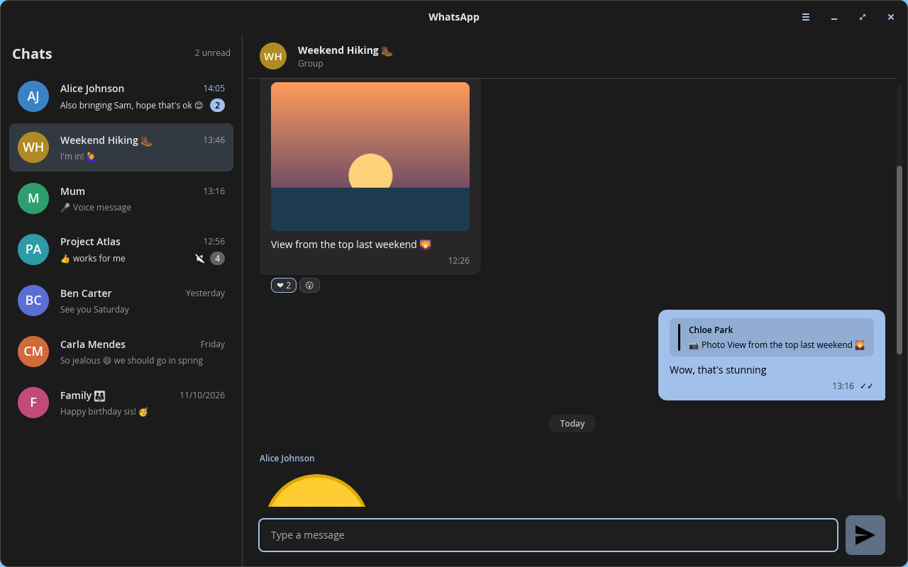

# WhatsApp for COSMIC

An unofficial, native WhatsApp client for the [COSMIC](https://github.com/pop-os/cosmic-epoch)
desktop, written in Rust with [libcosmic](https://github.com/pop-os/libcosmic).
It pairs with your phone as a *linked device* (the same mechanism as WhatsApp
Web) using the [`whatsapp-rust`](https://crates.io/crates/whatsapp-rust)
protocol library, so there is no browser, no Electron and no web view: just a
single binary that follows your COSMIC theme and accent colour.



> **Disclaimer.** This project is not affiliated with, authorised or endorsed by
> WhatsApp or Meta. Unofficial clients violate the WhatsApp Terms of Service and
> accounts have been banned for using them. Use it at your own risk.

## Features

**Messaging**
- QR-code pairing as a linked device; the session survives restarts and
  reconnects on its own after network drops
- Chat list for direct chats and groups, with profile pictures, unread counts,
  mute state and the last message preview
- Conversations with quoted replies, group sender names, date separators and
  infinite scroll-back through local history
- Send text (with replies); optimistic sending with delivery status icons:
  sending → sent → delivered → read, plus retry when a send fails
- Reactions: see everyone's, add your own from a quick bar or the full emoji
  picker, remove them again
- Read receipts are sent when you open a chat; reading on your phone clears
  the unread count here too

**Media**
- Images and stickers shown inline (small previews first, full image fetched
  automatically), with a full-size viewer
- Voice notes and audio with in-app playback (OGG/Opus)
- Documents and videos with download/open
- **Save to Downloads** on every image, video and document, named the way
  WhatsApp names files (`WhatsApp Image 2026-10-27 at 2.02 PM.jpg`)

**Desktop integration**
- Desktop notifications for new messages through COSMIC's notification
  daemon, with the sender's picture; one per chat that updates in place;
  clicking one opens the chat; previews optional
- A WhatsApp-style new-message chime (can be turned off in Settings)
- Proper app icon for the COSMIC app library and dock
- Optional start at login
- Graceful shutdown on window close, SIGTERM (logout) and SIGINT

**Look and feel**
- Dark theme by default, with Light and Match-system options
- Real colour emoji everywhere
- 12-hour clock, short dates ("12 Jan 2026")
- Outgoing bubbles tinted with your COSMIC accent colour

**Data**
- All history in a local SQLite database; media cached on disk; data
  directories are owner-only
- "Log out" unlinks the device and wipes everything local

Not supported (yet): voice/video calls, status/stories, sending media,
search, creating or administering groups, multiple accounts.

## Build and run

Requires stable Rust (1.94 or newer), `cmake` (for the bundled Opus build), the
Wayland development libraries (`libxkbcommon`, `wayland`), ALSA, and a colour
emoji font (`noto-fonts-emoji` on Arch).

```sh
cargo run --release -p wa-app            # real backend: scan the QR with your phone
cargo run --release -p wa-app -- --fake  # built-in demo backend: no network, throwaway data
cargo test --workspace                   # 150+ unit and integration tests, no network
```

With [`just`](https://github.com/casey/just):

```sh
just build          # release build
just run-fake       # demo mode
just check          # tests + clippy
just install-user   # install to ~/.local (binary, desktop entry, icons) — no root
sudo just install   # install to /usr (respects DESTDIR)
```

After `just install-user` the app appears in the COSMIC app library; launch it
and right-click its dock icon to pin it.

### Arch / CachyOS package

```sh
cd packaging && makepkg -si
```

Builds and installs `whatsapp-cosmic-git` from this repository.

### Where things live

| What | Where |
|---|---|
| Session keys and message database | `~/.local/share/whatsapp-cosmic/` |
| Downloaded media and profile pictures | `~/.cache/whatsapp-cosmic/media/` |
| Logs (daily files) | `~/.local/state/whatsapp-cosmic/log/` |
| Settings | COSMIC config (`cosmic-config`) |

Set `RUST_LOG=debug` for a more talkative log.

## How it works

```
┌────────────────────────── whatsapp-cosmic (one process) ──────────────────────────┐
│                                                                                    │
│   wa-app (libcosmic UI)      wa-core::runtime            wa-core::backend          │
│   ┌──────────────────┐   BackendCommand   ┌──────────┐  BackendCommand  ┌──────────┐│
│   │ pages/  widgets/ │ ─────────────────▶ │ persist  │ ───────────────▶ │ whatsapp ││
│   │ chat list, bubbles│ ◀───────────────── │ then     │ ◀─────────────── │  -rust   ││
│   │ composer, dialogs│   BackendEvent     │ forward  │  BackendEvent    │ (or fake)││
│   └────────┬─────────┘                    └────┬─────┘                  └──────────┘│
│            │ reads                             │ writes                             │
│            ▼                                   ▼                                    │
│          app.db (SQLite: chats, messages, reactions)                                 │
└────────────────────────────────────────────────────────────────────────────────────┘
```

- The UI never touches the protocol. It sends `BackendCommand`s (send text,
  react, mark read, fetch media, fetch avatar, log out) and renders state from
  `BackendEvent`s (QR, connection state, chats, messages, receipts, reactions,
  media ready, …) plus queries on the local store.
- The **runtime** sits between them: every event is written to SQLite *before*
  it is forwarded, outgoing messages are stored as *pending* before the backend
  sees them, and a dead backend turns into visible errors rather than silence.
- The **backend** is a trait (`WhatsAppBackend`), implemented twice: over
  `whatsapp-rust`, and as a scripted `FakeBackend` that drives the whole UI
  for tests, screenshots and `--fake`.

## Code layout

```
crates/
├── wa-core/                      protocol + storage, no UI dependencies
│   ├── src/model.rs              Chat, Message, MessageContent, MediaRef, Reaction …
│   ├── src/events.rs             BackendCommand / BackendEvent / ConnectionState
│   ├── src/backend.rs            the WhatsAppBackend trait
│   ├── src/backend/whatsapp_rust.rs   session lifecycle, reconnects, commands, media and
│   │                                  profile-picture downloads
│   ├── src/backend/whatsapp_rust/convert.rs   protocol messages → model (pure, well tested)
│   ├── src/backend/whatsapp_rust/index.rs     small side index: senders, quotable bodies,
│   │                                          chat names, mute state, LID↔phone mapping
│   ├── src/backend/fake.rs       scripted demo backend + bundled sample media
│   ├── src/runtime.rs            persist-then-forward pump, optimistic sends, logout wipe
│   ├── src/store.rs (+ store/schema.sql)   SQLite store: upserts, paging, receipts, reactions
│   ├── src/paths.rs              XDG directories (created owner-only)
│   └── examples/wa_cli.rs        headless pairing/debugging tool
├── wa-desktop/                   desktop integration, no UI toolkit
│   ├── src/notify.rs             freedesktop notifications with click-to-open
│   └── src/autostart.rs          ~/.config/autostart entry
└── wa-app/                       the libcosmic application (binary: whatsapp-cosmic)
    ├── src/main.rs               args, logging, launch
    ├── src/app.rs                cosmic::Application: state, update, view, subscriptions
    ├── src/backend_sub.rs        runs wa-core as an iced Subscription
    ├── src/config.rs             settings (appearance, previews) via cosmic-config
    ├── src/audio.rs              voice-note playback (rodio + Opus)
    ├── src/fonts.rs              puts the colour emoji font ahead of monochrome fallbacks
    ├── src/signals.rs            SIGTERM/SIGINT → graceful quit
    ├── src/pages/                login (QR), sync, chats (list), conversation, settings
    └── src/widgets/              message bubble, media (images/audio/files), reactions,
                                  avatars, icons and shared styling
resources/                        .desktop, AppStream metainfo, hicolor icons (SVG + PNG)
packaging/PKGBUILD                Arch package
docs/superpowers/                 the design spec and implementation plan this was built from
```

## Testing

- `cargo test --workspace` runs the unit and integration tests: store
  semantics (idempotent upserts, status never downgrades, paging), runtime
  ordering (persist before forward, optimistic send, logout wipe), protocol →
  model conversion against real protobuf messages, UI state transitions, file
  naming, and more. Nothing talks to WhatsApp servers.
- `--fake` exercises the full UI against the demo backend: seven chats with
  text, replies, images, a sticker, a voice note, a document, reactions, an
  unsupported message, failed sends and profile pictures.
- Real-account behaviour is checked by hand with the list below.

### Manual end-to-end checklist (real account)

- [ ] **Pair:** start the app, scan the QR code from WhatsApp → Linked devices; history sync completes and the chat list appears
- [ ] **Restart:** quit and start again; no QR code, chats load from the local database
- [ ] **Receive:** a message from another phone appears in the list and the open conversation; a notification shows when the window is not focused and clicking it opens the chat
- [ ] **Send:** send a text; the status icon goes sending → sent → delivered → read; reply to a message and check the quote on the phone
- [ ] **React:** react from the app and from the phone; both show, and your own reaction is highlighted
- [ ] **Media:** an incoming image and sticker display; a voice note plays; a document downloads and opens; Save to Downloads works
- [ ] **Profile pictures:** contacts and groups show their pictures
- [ ] **Reconnect:** disable networking for a minute, re-enable; the app reconnects and catches up
- [ ] **Remote logout:** remove the linked device on the phone; the app returns to the QR screen
- [ ] **Log out** from the app's menu wipes the local data

## Credits

- [`whatsapp-rust`](https://github.com/oxidezap/whatsapp-rust) (MIT) does the
  heavy lifting: pairing, the Signal protocol, media encryption, history sync.
- [libcosmic](https://github.com/pop-os/libcosmic) and
  [iced](https://github.com/iced-rs/iced) for the UI.
- WhatsApp and the WhatsApp logo are trademarks of WhatsApp LLC; they are used
  here only to identify the service this client connects to.

## License

GPL-3.0-or-later. See [LICENSE](LICENSE).
