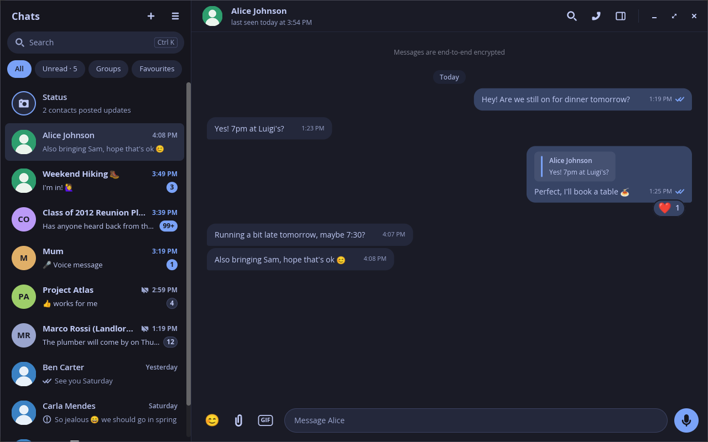
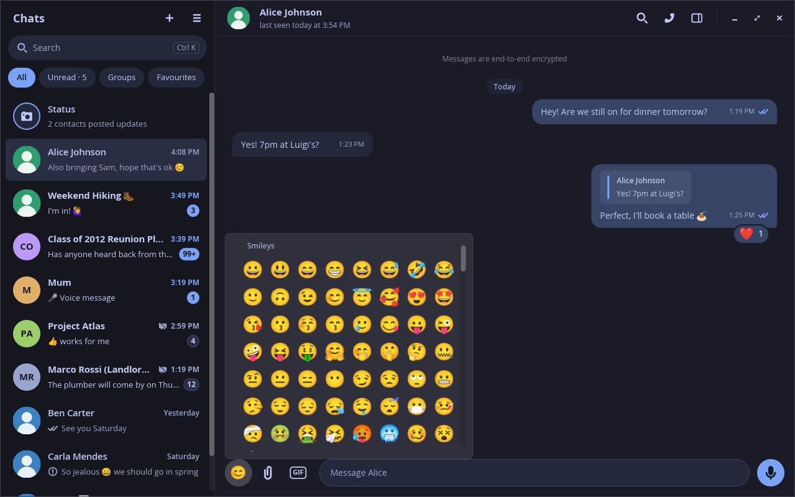
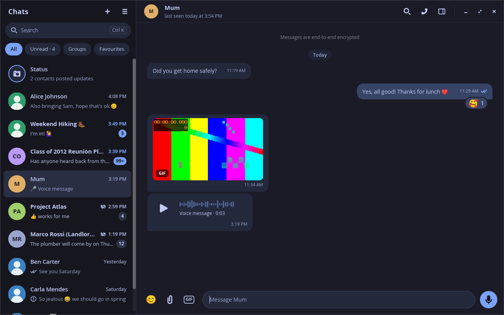
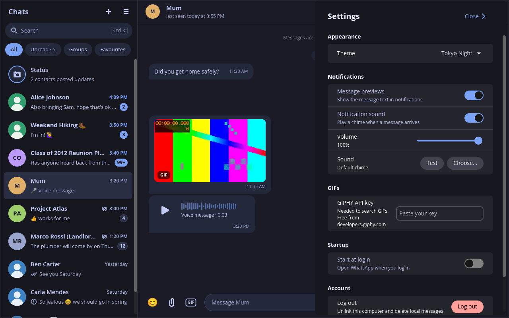

# WhatsApp for COSMIC

[](https://www.rust-lang.org)
[](https://github.com/pop-os/libcosmic)
[](https://wayland.freedesktop.org)
[](LICENSE)
[](#)

An unofficial, native WhatsApp client for the [COSMIC](https://github.com/pop-os/cosmic-epoch)
desktop, written in Rust with [libcosmic](https://github.com/pop-os/libcosmic).
It pairs with your phone as a *linked device* (the same mechanism as WhatsApp
Web) using the [`whatsapp-rust`](https://crates.io/crates/whatsapp-rust)
protocol library, so there is no browser, no Electron and no web view: just a
single binary, in a Tokyo Night look by default or following your COSMIC theme
and accent colour.



| Emoji panel | GIFs and voice messages | Settings |
|---|---|---|
|  |  |  |

All screenshots are of the built-in demo mode (`--fake`), not a real account.

> **Disclaimer.** This project is not affiliated with, authorised or endorsed by
> WhatsApp or Meta. Unofficial clients violate the WhatsApp Terms of Service and
> accounts have been banned for using them. Use it at your own risk.

## ✨ Features

### 💬 Messaging
- 🔗 **Linked-device pairing** — scan a QR code once; the session survives restarts and reconnects on its own after network drops
- 👤 **Chat list** for direct chats and groups, with profile pictures, unread badges, pin and mute icons, read ticks and the last message preview
- 🏷️ **Filters** — All, Unread, Groups and Favourites chips above the list; pin a chat to the top or add it to your favourites from its right-click menu (both are kept on this computer only)
- ➕ **New chat** — start a chat with someone from your list or by phone number
- 🧵 **Conversations** with quoted replies, group sender names, date separators and infinite scroll-back through local history
- ✈️ **Send text** (with replies) — optimistic sending with clear status icons: 🕓 sending → ✓ sent → ✓✓ delivered → ✓✓ read, plus retry when a send fails
- 😀 **Emoji panel** in the composer — about 400 emoji by category; it stays open so you can pick several
- ❤️ **Reactions** — see everyone's, add your own from a quick bar or the full emoji picker, remove them again
- 👀 **Read receipts** are sent when you open a chat; what you read or answer on your phone stops counting as unread here, and only messages that arrived after that keep their badge
- 🟢 **Online, last seen and typing** under the name in the conversation header. As with WhatsApp Web, you appear online yourself while the window is focused (WhatsApp only shares other people's status with clients that are online)
- ℹ️ **Contact details** panel for direct chats: picture, number, last seen, pin/favourite, call, search, delete
- 📞 **Voice calls** — answer incoming calls (Accept/Decline banner, ringtone, notification) or place one from a chat's header; mute and hang up, with a call timer. Audio runs through the library's end-to-end-encrypted VoIP engine; your microphone and speaker are driven through cpal (ALSA/PipeWire). Video calls are not supported: an incoming video call is answered as voice only.
- 📸 **Status updates** — a Status page shows your contacts' updates from the last 24 hours grouped by person (text, photos, videos) and lets you post your own text, photo or video status
- 👥 **Groups** — create a group from your chats or by phone number; a group-info panel shows members and roles, and lets admins rename, set the description, add, remove, promote and demote; anyone can copy the invite link or leave
- 🔍 **Search** chats by name and messages by text, caption or file name (Ctrl+K or Ctrl+F); a result opens the chat and outlines the message
- 🔎 **Search in a chat** — the magnifier in the conversation header steps through the matches in that chat
- 🗑️ **Delete** messages from the right-click menu — for you (synced to your phone) or, for your own messages, for everyone — and delete whole chats from the chat list

### 🖼️ Media
- 📷 **Images and stickers** inline (small previews first, full image fetched automatically), with a full-size viewer
- 🎙️ **Voice notes and audio** with in-app playback (OGG/Opus)
- 🎤 **Record voice messages** — the microphone button records from your default input; send or discard
- 🎞️ **GIFs** — search [GIPHY](https://giphy.com) from the composer (needs your own free API key, see below) and send the one you pick; GIFs, yours and other people's, show as a picture that plays in place when clicked (needs `ffmpeg`)
- 📄 **Documents and videos** with download and open
- ⬇️ **Save to Downloads** on every image, video and document, named the way WhatsApp names files (`WhatsApp Image 2026-10-27 at 2.02 PM.jpg`)
- 📎 **Send files** — attach with the 📎 button (COSMIC file chooser) or drop files onto the window; pictures are resized and re-encoded like WhatsApp does, with an optional caption; videos, audio and documents go as they are

### 🖥️ Desktop integration
- 🔔 **Notifications** through COSMIC's notification daemon, with the sender's picture; one per chat that updates in place; click to open the chat; previews optional
- 🔊 **New-message sound** — a short chime on every notification, with a Settings toggle, a volume slider and the option to use your own sound file (MP3, WAV, OGG, Opus or FLAC)
- 🧩 **App icon** for the COSMIC app library and dock
- 🚀 **Start at login** (optional)
- 🛑 **Graceful shutdown** on window close, SIGTERM (logout) and SIGINT

### 🎨 Look and feel
- 🌃 **Tokyo Night by default**, with Dark, Light and Match-system options that take their colours from your COSMIC theme and accent
- 🪟 **No title bar** — the window buttons sit in the conversation header, and both pane headers drag the window
- 😀 **Real colour emoji** everywhere
- 🕐 **12-hour clock** and short dates ("12 Jan 2026")
- 🎯 **Accent-tinted** outgoing bubbles

### 🔒 Data
- 🔐 **Encrypted at rest** — the message history, the session with its Signal keys and the backend's index are SQLCipher databases (AES-256). The key is a random 256-bit value kept in your desktop keyring (Secret Service, e.g. gnome-keyring), fetched silently at launch; a copied database file is useless without it, and plain `sqlite3` refuses to open one. Databases from earlier versions are encrypted in place on first start
- 🗄️ All history in a local SQLite database; media cached on disk; data directories are owner-only
- 🚪 **Log out** unlinks the device and wipes everything local

## Build and run

Requires stable Rust (1.94 or newer), `cmake` (for the bundled Opus build), the
Wayland development libraries (`libxkbcommon`, `wayland`), ALSA, OpenSSL (for
the bundled SQLCipher build), a running Secret Service keyring (gnome-keyring
or KWallet) and a colour emoji font (`noto-fonts-emoji` on Arch). `ffmpeg` is
optional: with it, GIFs play in place; without it they show as a still picture.

```sh
cargo run --release -p wa-app            # real backend: scan the QR with your phone
cargo run --release -p wa-app -- --fake  # built-in demo backend: no network, throwaway data
cargo test --workspace                   # about 200 unit and integration tests, no network
```

With [`just`](https://github.com/casey/just):

```sh
just build          # release build
just run-fake       # demo mode
just check          # tests + clippy
just install-user   # install to ~/.local (binary, desktop entry, icons) — no root
sudo just install   # install to /usr (respects DESTDIR)
```

After `just install-user` the app appears in the COSMIC app library; launch it
and right-click its dock icon to pin it.

### Arch / CachyOS package

```sh
cd packaging && makepkg -si
```

Builds and installs `whatsapp-cosmic-git` from this repository.

### GIF search

GIF search uses the GIPHY API, which needs a key of your own. Create a free
one at [developers.giphy.com](https://developers.giphy.com) and paste it into
Settings → GIFs. Your search words are sent to GIPHY; the key is stored with
the app's other settings, unencrypted.

### Where things live

| What | Where |
|---|---|
| Session keys and message database (SQLCipher-encrypted) | `~/.local/share/whatsapp-cosmic/` |
| Database key | your desktop keyring, attributes `app=whatsapp-cosmic purpose=database-key` |
| Downloaded media and profile pictures (not encrypted) | `~/.cache/whatsapp-cosmic/media/` |
| Logs (daily files) | `~/.local/state/whatsapp-cosmic/log/` |
| Settings | COSMIC config (`cosmic-config`) |

Set `RUST_LOG=debug` for a more talkative log.

To inspect a database by hand you need a SQLCipher-capable client and the key
from the keyring (`secret-tool lookup app whatsapp-cosmic purpose database-key | xxd -p`),
applied as `PRAGMA key = "x'<hex>'"`. Deleting the keyring entry makes the
databases unreadable for good: you would have to log out and pair again.

## How it works

```
┌────────────────────────── whatsapp-cosmic (one process) ──────────────────────────┐
│                                                                                    │
│   wa-app (libcosmic UI)      wa-core::runtime            wa-core::backend          │
│   ┌──────────────────┐   BackendCommand   ┌──────────┐  BackendCommand  ┌──────────┐│
│   │ pages/  widgets/ │ ─────────────────▶ │ persist  │ ───────────────▶ │ whatsapp ││
│   │ chat list, bubbles│ ◀───────────────── │ then     │ ◀─────────────── │  -rust   ││
│   │ composer, dialogs│   BackendEvent     │ forward  │  BackendEvent    │ (or fake)││
│   └────────┬─────────┘                    └────┬─────┘                  └──────────┘│
│            │ reads                             │ writes                             │
│            ▼                                   ▼                                    │
│          app.db (SQLCipher-encrypted SQLite: chats, messages, reactions)             │
└────────────────────────────────────────────────────────────────────────────────────┘
```

- The UI never touches the protocol. It sends `BackendCommand`s (send text,
  react, mark read, fetch media, fetch avatar, log out) and renders state from
  `BackendEvent`s (QR, connection state, chats, messages, receipts, reactions,
  media ready, …) plus queries on the local store.
- The **runtime** sits between them: every event is written to SQLite *before*
  it is forwarded, outgoing messages are stored as *pending* before the backend
  sees them, and a dead backend turns into visible errors rather than silence.
- The **backend** is a trait (`WhatsAppBackend`), implemented twice: over
  `whatsapp-rust`, and as a scripted `FakeBackend` that drives the whole UI
  for tests, screenshots and `--fake`.

## Code layout

```
crates/
├── wa-core/                      protocol + storage, no UI dependencies
│   ├── src/model.rs              Chat, Message, MessageContent, MediaRef, Reaction …
│   ├── src/events.rs             BackendCommand / BackendEvent / ConnectionState
│   ├── src/backend.rs            the WhatsAppBackend trait
│   ├── src/backend/whatsapp_rust.rs   session lifecycle, reconnects, commands, media and
│   │                                  profile-picture downloads
│   ├── src/backend/whatsapp_rust/convert.rs   protocol messages → model (pure, well tested)
│   ├── src/backend/whatsapp_rust/index.rs     small side index: senders, quotable bodies,
│   │                                          chat names, mute state, LID↔phone mapping
│   ├── src/backend/fake.rs       scripted demo backend + bundled sample media
│   ├── src/runtime.rs            persist-then-forward pump, optimistic sends, logout wipe
│   ├── src/store.rs (+ store/schema.sql)   SQLite store: upserts, paging, receipts, reactions
│   ├── src/dbkey.rs              SQLCipher key from the desktop keyring, keyed opens,
│   │                             in-place encryption of older plaintext databases
│   ├── src/paths.rs              XDG directories (created owner-only)
│   └── examples/wa_cli.rs        headless pairing/debugging tool
├── wa-desktop/                   desktop integration, no UI toolkit
│   ├── src/notify.rs             freedesktop notifications with click-to-open
│   └── src/autostart.rs          ~/.config/autostart entry
└── wa-app/                       the libcosmic application (binary: whatsapp-cosmic)
    ├── src/main.rs               args, logging, launch
    ├── src/app.rs                cosmic::Application: state, update, view, subscriptions
    ├── src/backend_sub.rs        runs wa-core as an iced Subscription
    ├── src/config.rs             settings (appearance, notifications, GIPHY key) via cosmic-config
    ├── src/tokens.rs             the redesign's colours and sizes (Tokyo Night)
    ├── src/style.rs              palette for the active theme and shared widget styles
    ├── src/audio.rs              voice-note and notification-sound playback (rodio + Opus)
    ├── src/recorder.rs           voice message recording (cpal) and Ogg/Opus encoding
    ├── src/giphy.rs              GIPHY search and download
    ├── src/gifplay.rs            decodes GIF clips into frames with ffmpeg
    ├── src/fonts.rs              puts the colour emoji font ahead of monochrome fallbacks
    ├── src/signals.rs            SIGTERM/SIGINT → graceful quit
    ├── src/pages/                login (QR), sync, chats (list), conversation, settings
    └── src/widgets/              message bubble, media (images/GIFs/audio/files), reactions,
                                  emoji, avatars, icons and window controls
resources/                        .desktop, AppStream metainfo, hicolor icons (SVG + PNG)
packaging/PKGBUILD                Arch package
docs/superpowers/                 the design spec and implementation plan this was built from
```

## Testing

- `cargo test --workspace` runs the unit and integration tests: store
  semantics (idempotent upserts, status never downgrades, paging), runtime
  ordering (persist before forward, optimistic send, logout wipe), protocol →
  model conversion against real protobuf messages, UI state transitions, file
  naming, and more. Nothing talks to WhatsApp servers.
- `--fake` exercises the full UI against the demo backend: nine chats with
  text, replies, images, a sticker, a GIF, a voice note, a document, reactions,
  an unsupported message, failed sends, long names and profile pictures.
- Real-account behaviour is checked by hand with the list below.

### Manual end-to-end checklist (real account)

- [ ] **Pair:** start the app, scan the QR code from WhatsApp → Linked devices; history sync completes and the chat list appears
- [ ] **Restart:** quit and start again; no QR code, chats load from the local database
- [ ] **Encrypted at rest:** `sqlite3 ~/.local/share/whatsapp-cosmic/app.db .tables` fails with "file is not a database"; `secret-tool lookup app whatsapp-cosmic purpose database-key` returns the key
- [ ] **Receive:** a message from another phone appears in the list and the open conversation; a notification shows when the window is not focused and clicking it opens the chat
- [ ] **Send:** send a text; the status icon goes sending → sent → delivered → read; reply to a message and check the quote on the phone
- [ ] **React:** react from the app and from the phone; both show, and your own reaction is highlighted
- [ ] **Media:** an incoming image and sticker display; a voice note plays; a document downloads and opens; Save to Downloads works
- [ ] **Profile pictures:** contacts and groups show their pictures
- [ ] **Delete:** "Delete for everyone" on your own message shows the placeholder on the phone too; "Delete for me" and "Delete chat" disappear on the phone
- [ ] **Send media:** a photo (with caption), a video, an audio file and a PDF arrive on the phone and display correctly; a reply to a message with a photo keeps the quote
- [ ] **Voice calls:** an incoming call rings (banner + notification), Accept connects with two-way audio, Mute silences the microphone, End hangs up on both sides; an outgoing call rings the phone and connects when answered; Decline and a cancelled call clear the banner
- [ ] **Status:** a contact's text and photo updates appear on the Status page; posting a text and a photo status shows them on the phone's Status tab
- [ ] **Groups:** create a group (it appears on the phone); rename it, set a description, add and remove a member, make and dismiss an admin, copy the invite link; leave a group
- [ ] **Read elsewhere:** read some of a chat's unread messages on the phone; the badge here drops to the ones that arrived after; reply from the phone and it clears
- [ ] **Presence:** a contact's "online" / "last seen" line appears under their name while the window is focused; "typing…" shows while they type
- [ ] **Voice message:** record one with the microphone button; it arrives on the phone as a voice message and plays
- [ ] **GIFs:** with a GIPHY key set, search, pick and send a GIF; it loops on the phone, and a GIF received from the phone plays here when clicked
- [ ] **Notification sound:** the volume slider changes the loudness; a custom sound file plays and Reset restores the chime
- [ ] **Reconnect:** disable networking for a minute, re-enable; the app reconnects and catches up
- [ ] **Remote logout:** remove the linked device on the phone; the app returns to the QR screen
- [ ] **Log out** from the app's menu wipes the local data

## Credits

- [`whatsapp-rust`](https://github.com/oxidezap/whatsapp-rust) (MIT) does the
  heavy lifting: pairing, the Signal protocol, media encryption, history sync.
- [libcosmic](https://github.com/pop-os/libcosmic) and
  [iced](https://github.com/iced-rs/iced) for the UI.
- GIF search is powered by [GIPHY](https://giphy.com); the colours are
  [Tokyo Night](https://github.com/tokyo-night/tokyo-night-vscode-theme).
- WhatsApp and the WhatsApp logo are trademarks of WhatsApp LLC; they are used
  here only to identify the service this client connects to.

## License

GPL-3.0-or-later. See [LICENSE](LICENSE).
